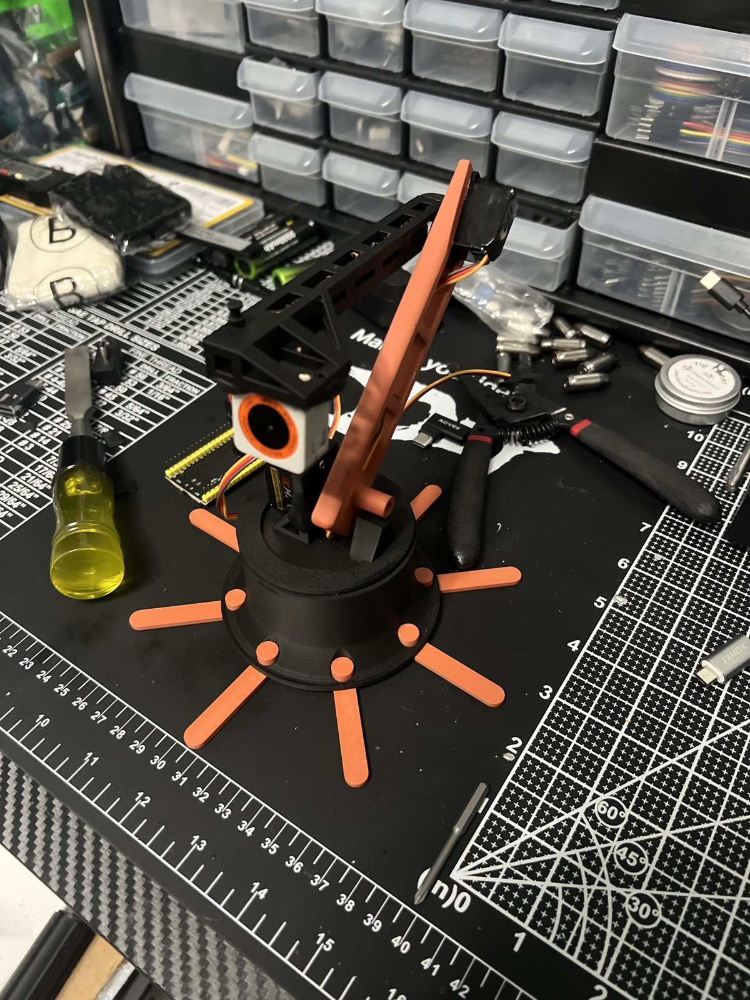
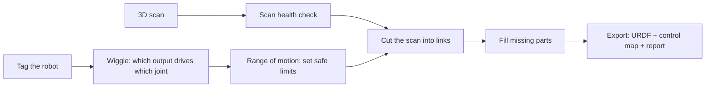
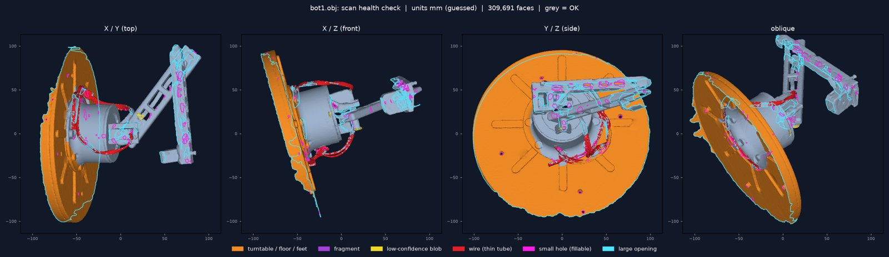
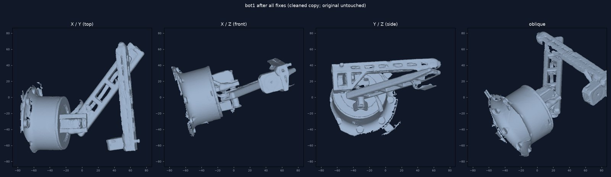

# Digital Twin Generator

**Built robot in, verified simulation-ready model out.**

Put a servo robot on the desk — unknown wiring, no CAD — and get back a model of *that exact
robot*: which output drives which joint, each joint's real axis and safe range, the robot's
geometry cut into links, and a URDF ready for simulation and reinforcement learning.

## The pipeline

1. **Scan health check.** Finds what 3D scans get wrong on robots — the floor and turntable
   welded to the base, servo wires captured as blobs, holes, fragments — and fixes them on a copy.
2. **Wiggle.** Each controller output is nudged slightly while a camera watches the tags.
   Whatever moves tells it which output drives which joint, and which way. Unused outputs and
   unclear cases are flagged for the operator, never guessed.
3. **Range of motion.** The operator slides each servo slowly to its two safe ends. The camera
   records the real joint axis and limits at the same time. Works with any servo, any direction,
   even a mis-mounted horn.
4. **Cut the scan** into links from what moved together.
5. **Missing parts** are filled from the scan, a second scan, a library of real servo bodies, or
   a stand-in — and every part keeps a label saying where it came from.
6. **Export** a URDF with real joint limits, a channel → joint control map, and a report.

## Results so far

End-to-end virtual bench: 26 randomized 3-joint arms with hidden wiring, direction,
mis-mounted horns, backlash and hard stops. The real robo-prober firmware runs behind a
virtual serial port, and a rendered camera is tuned to real OAK-D noise.

**Safety: passed on 26 of 26 arms.**

| Check | Result |
|---|---|
| Nothing moves before arming; arming needs a confirmed power cutoff | 26/26 |
| Servo pulses outside the operator's set range (of 220,902) | 0 |
| Hard-stop contact | 0 |
| Speed cap, watchdog release (~1 s), latching e-stop (< 4 ms) | 26/26 |
| Jump on first move | ≤ 1.5° (limit 3°) |
| Wrong or unused outputs silently mapped to a joint | 0 |

**Accuracy: a work in progress, and reported as measured.**

Joints the tool reported as confident:

| Check | Median / worst |
|---|---|
| Joint axis | 0.5° / 3.6° |
| Joint pivot | 2.9 mm / 6.8 mm |
| Joint limits | 0.4° / 2.8° |
| Pulse → angle | 0.2% / 2.7% |
| Direction | always correct |

Large errors only showed up on joints the tool had already flagged for the operator.

A real scan of the test arm went through the health check. It found the floor/turntable,
3 wire loops, 61 holes (46 of them auto-fillable) and 7 fragments.

*Health check on a real scan of the test arm: orange = turntable/floor, red = wires, magenta =
fillable holes, cyan = large openings.*

*The cleaned copy. The original scan is never modified.*

## Status

Working prototype. The full pipeline and its safety are validated on the virtual bench, and
the scan health check runs on a real scan. Pivot accuracy, and range ends that one tag
per link can't see, are the next things to improve. Next: the first live wiggle and range sweep on the test arm.
Source is private.

## Built on

- [aruco-tag-maker](https://github.com/evilhobo1911/aruco-tag-maker) — the tags (open source)
- [robo-prober](https://github.com/evilhobo1911/robo-prober) — safe servo control and range of motion (open source)
