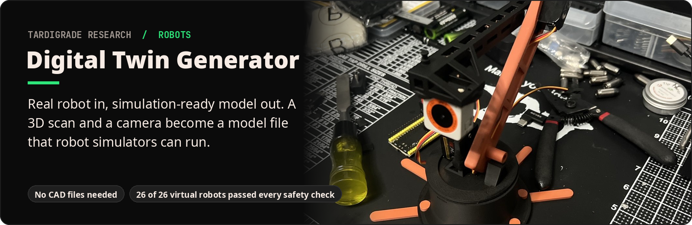
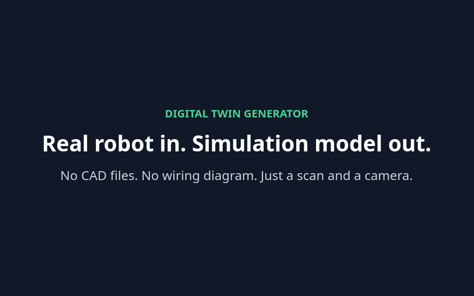
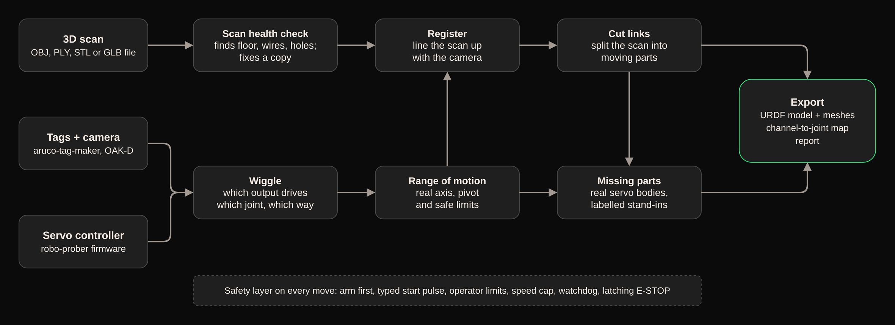

**What it is.** Desktop software that turns a physical servo robot into a "digital twin", a model of *that exact robot* that a simulator can run.

**What it does.** From a 3D scan and a camera watching the robot move, it works out which motor drives which joint, how far each joint can safely move, and the shape of every moving part. Then it writes the model file (URDF).

**Why it matters.** Robots are usually trained in simulation before they touch the real world. Normally that needs CAD drawings and careful hand measurement; this tool measures the robot itself, safely, in one guided session.

## How it works

- **Never guesses.** Unclear wiring or a poor joint fit is flagged for the operator instead of being silently mapped.
- **Handles real-world builds:** any servo direction, backlash, even a mis-mounted horn.
- **Nothing is lost.** Scan fixes happen on a copy, and every filled-in part is labelled with where it came from.

## Results

Tested end to end on a virtual bench: 26 randomized 3-joint arms with hidden wiring, reversed directions, mis-mounted horns, backlash and hard stops. The real controller firmware runs behind a virtual serial port, and a rendered camera is tuned to real OAK-D depth-camera noise.

**Safety: 26 of 26 arms passed every check.**

| Safety check | Result |
|---|---|
| Nothing moves before arming; arming needs a confirmed power cutoff | 26/26 |
| Servo pulses outside the operator's set range (of 220,902 sent) | 0 |
| Hard-stop contact | 0 |
| Speed cap, watchdog release (~1 s), latching E-STOP (< 4 ms) | 26/26 |
| Jump on first move | ≤ 1.5° (limit 3°) |
| Wrong or unused outputs silently mapped to a joint | 0 |

**Accuracy** on joints the tool reported as confident:

| Measurement | Median / worst |
|---|---|
| Joint axis | 0.5° / 3.6° |
| Joint pivot | 2.9 mm / 6.8 mm |
| Joint limits | 0.4° / 2.8° |
| Pulse to angle | 0.2% / 2.7% |
| Direction | always correct |

On a real scan of the test arm (310k faces), the health check found the turntable, 3 servo-wire loops, 61 holes (46 auto-filled) and 7 fragments in about 18 seconds.

## Built with

- [digital_twin_generator](https://github.com/tardigraderesearch/digital_twin_generator): the desktop app's source code, with install and quickstart
- [aruco-tag-maker](https://github.com/tardigraderesearch/aruco-tag-maker): the printed tags
- [robo_prober](https://github.com/tardigraderesearch/robo_prober): safe servo control and the controller firmware
