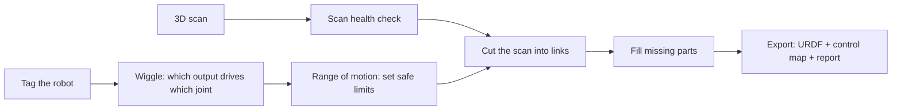

# Digital Twin Generator

**Built robot in, verified simulation-ready model out.**

Put a servo robot on the desk — unknown wiring, no CAD — and get back a model of *that exact
robot*: which output drives which joint, each joint's real axis and safe range, the robot's
geometry cut into links, and a URDF ready for simulation and reinforcement learning.

## The pipeline

1. **Scan health check.** Finds what 3D scans get wrong on robots — the floor and turntable
   welded to the base, servo wires captured as blobs, holes, fragments — and fixes them on a copy.
2. **Wiggle.** Each controller output is nudged slightly while a camera watches the tags.
   Whatever moves tells it which output drives which joint, and which way. Unused outputs and
   unclear cases are flagged for the operator, never guessed.
3. **Range of motion.** The operator slides each servo slowly to its two safe ends. The camera
   records the real joint axis and limits at the same time. Works with any servo, any direction,
   even a mis-mounted horn.
4. **Cut the scan** into links from what moved together.
5. **Missing parts** are filled from the scan, a second scan, a library of real servo bodies, or
   a stand-in — and every part keeps a label saying where it came from.
6. **Export** a URDF with real joint limits, a channel → joint control map, and a report.

## Results so far

| Check | Result |
|---|---|
| Output → joint mapping (simulated arm, scrambled wiring + unused outputs) | Exact |
| Joint axis from the range-of-motion sweep | ≤ 1.2° error |
| Joint pivot position | ≤ 2 mm |
| Joint limits | within ~1° |
| Tag dropout (5%) | flagged, never silently mismapped |
| Real arm scan health check | floor/turntable, 3 wire loops, 61 holes (46 auto-fillable), 7 fragments found |

*Health check on a real scan of the test arm: orange = turntable/floor, red = wires, magenta =
fillable holes, cyan = large openings.*

*The cleaned copy. The original scan is never modified.*

## Status

Working prototype. The tracking and range math is validated on simulated data; the scan
health check runs on a real scan. Next: the first live wiggle and range sweep on the test arm.
Source is private.

## Built on

- [aruco-tag-maker](https://github.com/evilhobo1911/aruco-tag-maker) — the tags (open source)
- [robo-prober](https://github.com/evilhobo1911/robo-prober) — safe servo control and range of motion (open source)

## How this was built
AI is used here as a tool to speed up implementation. I design the system and
define what "working" means. When issues are found, they're identified, and
ARI — my own agent system — fixes them against those checks.

---
© 2026 evilhobo1911. All rights reserved.
